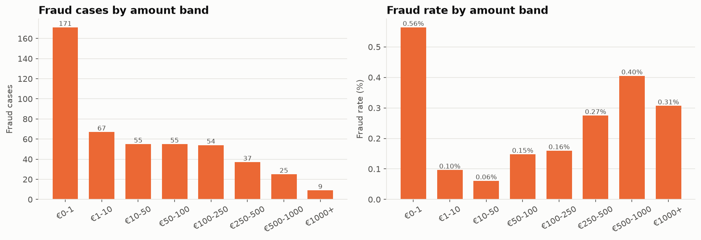
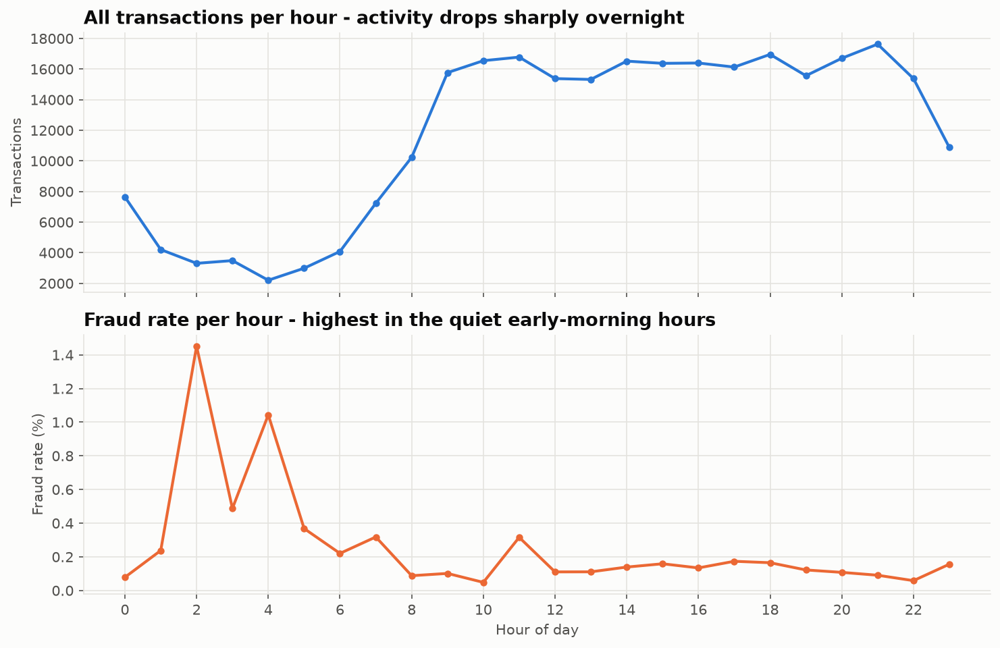
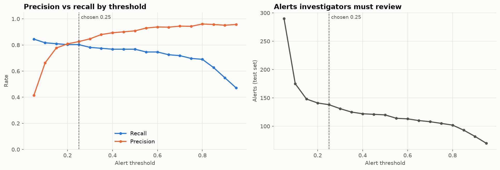

# Credit Card Fraud Analysis

A banking analytics project. As a **Fraud Data Analyst**, I analyse 284,807 card transactions to find where fraud happens and what it costs. I then size a monitoring system that catches fraud without flooding investigators with false alerts.

**Tools:** Python (pandas, NumPy, Matplotlib, Seaborn, scikit-learn, imbalanced-learn) · SQL (SQLite) · Tableau

## Key results

| | |
|---|---|
| Transactions analysed (after removing 1,081 duplicates) | **283,726** |
| Fraud cases / rate | **473 / 0.167%** |
| Total fraud value | **€58,591** |
| Peak fraud rate | **1.45% at 2 am**, 9× the average |
| Share of fraud value in transactions of €250+ | **74%**, from only 15% of fraud cases |
| Best model | Random Forest, PR-AUC **0.81** |
| Fraud caught at the chosen threshold (test set) | **80%** of cases and of value, with only **24 false alerts** in 85,118 transactions |

Full findings and recommendations: **[reports/business_recommendations.md](reports/business_recommendations.md)**

**Interactive dashboard:** open `dashboard/fraud_dashboard.html` in a browser. It has a day filter, a cases/rate/value toggle and an alert-threshold slider that recalculates every model number live.





## Business questions answered

| Question | Where |
|---|---|
| What % of transactions are fraud? Typical fraud vs legitimate amount? | Notebook 02, SQL Q1-Q2 |
| Is fraud concentrated in certain hours? | Notebook 02, SQL Q4 and Q6 |
| Total fraud value? Which amount ranges hold the most fraud? | Notebook 02, SQL Q3 and Q5 |
| How many alerts must investigators review? How much fraud is caught or missed? How many false alerts? | Notebook 04, SQL Q7-Q8 |

## Project structure

```
credit-card-fraud-analysis/
├── README.md
├── requirements.txt
├── run_all.sh                        # runs everything end to end
├── data/README.md                    # where to download the dataset
├── notebooks/
│   ├── 01_data_cleaning.ipynb        # quality checks, remove duplicates
│   ├── 02_exploratory_analysis.ipynb # patterns: amount, time, value
│   ├── 03_imbalance_experiments.ipynb# baseline vs class weights vs SMOTE vs Random Forest
│   └── 04_model_evaluation.ipynb     # threshold choice + business impact
├── src/
│   ├── preprocessing.py              # load + clean
│   ├── features.py                   # hour, day, log amount, amount band
│   ├── train.py                      # the four models
│   ├── evaluate.py                   # metrics + money view (cost assumptions here)
│   └── plots.py                      # shared chart style
├── sql/
│   ├── fraud_analysis.sql            # 8 queries: CTEs, window functions, conditional counts
│   └── run_sql.py                    # loads data into SQLite and runs the queries
├── dashboard/
│   ├── fraud_dashboard.html          # interactive dashboard - open in a browser
│   ├── build_dashboard.py            # rebuilds it from dashboard/data/
│   ├── dashboard_template.html       # page layout and charts (Chart.js)
│   ├── README.md                     # step-by-step Tableau build guide
│   └── data/                         # Tableau-ready CSVs (created by the notebooks)
├── reports/business_recommendations.md
└── visuals/                          # every chart as PNG
```

## How to run

```bash
# 1. Create an environment and install the libraries
python3 -m venv .venv
source .venv/bin/activate
pip install -r requirements.txt

# 2. Download the dataset (about 150 MB) - see data/README.md
curl -L -o data/creditcard.csv https://storage.googleapis.com/download.tensorflow.org/data/creditcard.csv

# 3. Run everything (about 3 minutes)
./run_all.sh
```

To explore step by step instead, run `jupyter notebook` and open the notebooks in order (01 → 04), then run `python sql/run_sql.py`.

## Method

1. **Cleaning.** No missing values. 1,081 exact duplicate rows removed. Zero-amount transactions kept (card checks, not errors).
2. **EDA.** Fraud vs legitimate amounts, fraud **count vs rate vs value** by amount band, and hour-of-day patterns.
3. **Features.** Hour of day, day, log-transformed amount, amount band.
4. **Imbalance handling.** Baseline logistic regression vs class weights vs SMOTE (applied to **training data only**, inside a pipeline) vs a class-weighted Random Forest. 70/30 stratified split.
5. **Evaluation.** Precision, recall, F1 and PR-AUC, not accuracy: predicting "legitimate" for everything is 99.83% accurate and catches nothing.
6. **Business impact.** The alert threshold is chosen to maximise net benefit = fraud value caught − review cost (€5 per alert, an assumption set in `src/evaluate.py`).

## Limitations

- `V1` to `V28` are anonymised PCA components. This project makes no claims about what they represent.
- There is no location, merchant or customer data, so geographic hotspots cannot be analysed.
- The data covers 2 days in 2013. Hour of day assumes the data starts at midnight.

## Data source

ULB Machine Learning Group, [Credit Card Fraud Detection (Kaggle)](https://www.kaggle.com/datasets/mlg-ulb/creditcardfraud). The raw data is not committed to this repository; see [data/README.md](data/README.md).
